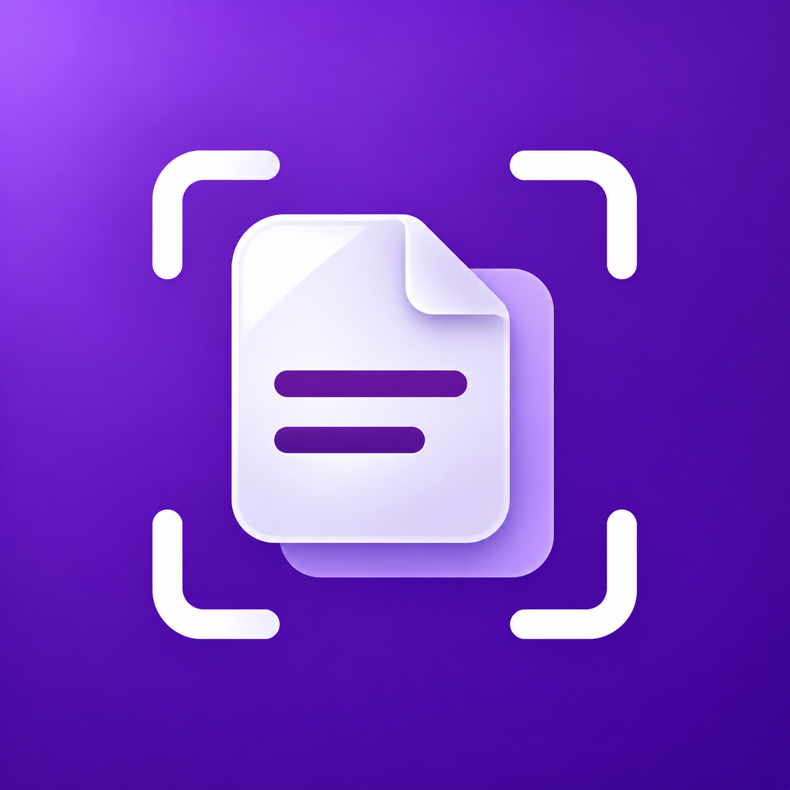
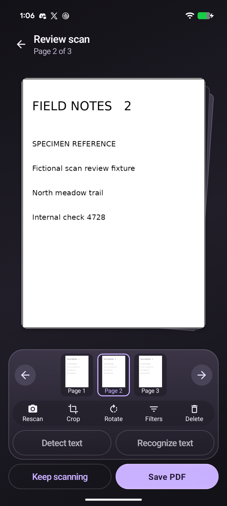
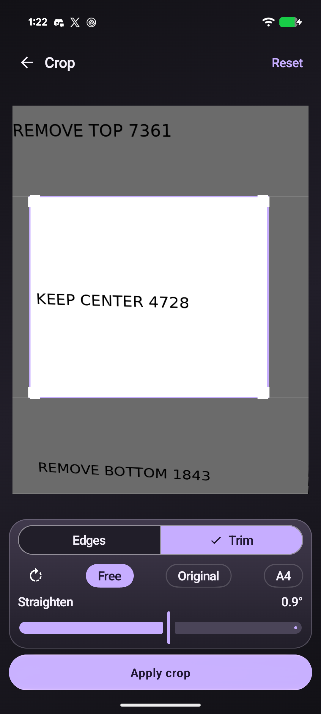

<div align="center">
  
  <h1>Nobi Scan</h1>
  <p>Scan, clean up, read, and manage PDFs offline on Android.</p>
  <p><a href="#install">Install</a> · <a href="#features">Features</a> · <a href="#build-from-source">Build</a> · <a href="#open-source-credits">Credits</a> · <a href="#privacy">Privacy</a></p>
</div>

## Install

| Channel | Build | Package |
| --- | --- | --- |
| Stable candidate | `1.0.0-rc4` | `com.nobi.scan` |
| Alpha tester | `1.0-alpha21` | `com.nobi.scan.alpha` |

Check the repository’s **Releases** tab for published APKs, checksums, and source. The supplied APKs target ARM64 devices running Android 12L or later. Alpha and Stable can be installed side by side. Each keeps its own library.

## Features

- Capture pages with the camera or import several photos into one draft.
- Correct perspective, trim, straighten, reorder, and apply filters.
- Recognize printed English, Assamese, and Hindi offline. Save ordinary or searchable PDFs.
- Read, merge, split, organize, and compress PDFs locally.

<details>
<summary>How do I make a searchable PDF?</summary>

From Review scan, tap **Save PDF**, enable **Searchable PDF**, and choose the document’s language. Use a PDF reader with Find to search the exported text. Printed Assamese recognition can still produce vowel-mark errors.

</details>

<details>
<summary>What stays on my phone?</summary>

The app keeps saved PDFs in its private library. Use **Export a copy** to save a separate file at a location you choose. Clearing app data or uninstalling removes the private library.

</details>

<details>
<summary>How do I report an issue?</summary>

Include the Nobi Scan version, Android version, device model, and steps to reproduce. For PDF-specific issues, use a synthetic example with no personal information.

</details>

## Screenshots

<p>
  
  
</p>

## Build from source

Use JDK 17, Android SDK Platform 37, and the included Gradle wrapper. Start from the release tag to build the source corresponding to a specific APK.

```sh
./gradlew :app:assembleRelease :app:lintRelease :app:testDebugUnitTest
```

The release APK is generated under `app/build/outputs/apk/release/`. Official upgrades use the established signing certificate for that channel. See [PROJECT_STATUS.md](PROJECT_STATUS.md) for verification history.

## Open-source credits

| Project | How Nobi Scan uses it |
| --- | --- |
| [FairScan](https://github.com/pynicolas/FairScan) | Adapted the four-corner crop editor, corner interaction, coordinate utilities, and magnifier. The adapted files retain their GPL-3.0-or-later notices. |
| [OpenCV](https://github.com/opencv/opencv) | Detects document contours and proposes crop corners. |
| [Glasmio](https://github.com/NEORUAA/Glasmio) | Renders glass surfaces and navigation effects. |
| [AndroidX](https://github.com/androidx/androidx) | CameraX handles capture. Jetpack Compose and Material 3 provide the interface foundations. |
| [Tesseract4Android](https://github.com/adaptech-cz/tesseract4android), [Tesseract](https://github.com/tesseract-ocr/tesseract), and [tessdata_fast](https://github.com/tesseract-ocr/tessdata_fast) | Run on-device OCR using the bundled English, Assamese, and Hindi models. |
| [PdfBox-Android](https://github.com/TomRoush/PdfBox-Android) | Edits PDF pages, embeds searchable text, and recompresses eligible images. |
| [Noto](https://github.com/notofonts) | Provides font data for searchable PDF text. |

[DocScannerPro](https://github.com/REBEL-ROOT/DocScannerPro) is credited in the source as a contour fallback reference. [Docucraft](https://github.com/BobbyESP/Docucraft), [OSS Document Scanner](https://github.com/ossappscollective/OSS-DocumentScanner), and [OpenScan](https://github.com/ethereal-developers/OpenScan) were workflow references.

See [THIRD_PARTY.md](THIRD_PARTY.md) for versions and provenance, the [bundled notices](app/src/main/assets/notices/) for third-party terms, and [LICENSE](LICENSE) for Nobi Scan’s GPL license text.

## Privacy

Scanning, OCR, and PDF processing run on the device. The **More tools** link opens GitHub in an external app.
